# 🎬 MovieFlix: Enterprise Hybrid Movie Recommendation System

[](https://www.python.org/)
[](https://streamlit.io/)
[](https://scikit-learn.org/)
[](https://pandas.pydata.org/)
[](https://numpy.org/)
[](https://grouplens.org/datasets/movielens/)
[](https://www.themoviedb.org/)
[](https://opensource.org/licenses/MIT)

**MovieFlix** is a high-performance, full-stack hybrid movie recommendation engine and interactive streaming discovery platform. Built upon the **MovieLens 32M** dataset and enriched with real-time **TMDB (The Movie Database) API v3** metadata, MovieFlix bridges the gap between theoretical recommender systems and responsive web applications.

The platform orchestrates **five distinct recommendation algorithms**—Bayesian Popularity, TF-IDF Content-Based Filtering, Mean-Centered User-User Collaborative Filtering (Resnick deviation), Top-$K$ Item-Item Collaborative Filtering, and an adaptive Three-Signal Hybrid Engine. It features end-to-end solutions for both **User Cold-Start** and **Item Cold-Start**, interactive catalog pagination across 87,585 movies, release year filtering, fast type-ahead search, TMDB poster streaming, and persistent user watchlists.

---

## 📑 Table of Contents

- [1. Project Introduction](#1-project-introduction)
  - [Overview](#overview)
  - [Problem Statement](#problem-statement)
  - [Motivation](#motivation)
  - [Project Objectives](#project-objectives)
  - [Key Features](#key-features)
  - [What Makes MovieFlix Different](#what-makes-movieflix-different)
- [2. Complete End-to-End Architecture & Workflow](#2-complete-end-to-end-architecture--workflow)
  - [A. Dataset Collection & Ingestion](#a-dataset-collection--ingestion)
  - [B. Data Preprocessing & Feature Engineering](#b-data-preprocessing--feature-engineering)
  - [C. Exploratory Data Analysis (EDA)](#c-exploratory-data-analysis-eda)
  - [D. Collaborative Filtering Matrix Preparation](#d-collaborative-filtering-matrix-preparation)
- [3. Mathematical & Algorithmic Formulations](#3-mathematical--algorithmic-formulations)
  - [1. Bayesian Popularity-Based Weighted Rating](#1-bayesian-popularity-based-weighted-rating)
  - [2. Content-Based Filtering (TF-IDF + TMDB Enrichment)](#2-content-based-filtering-tf-idf--tmdb-enrichment)
  - [3. Mean-Centered User-User Collaborative Filtering](#3-mean-centered-user-user-collaborative-filtering)
  - [4. Top-$K$ Item-Item Collaborative Filtering](#4-top-k-item-item-collaborative-filtering)
  - [5. Three-Signal Hybrid Recommendation Engine](#5-three-signal-hybrid-recommendation-engine)
  - [6. Cold-Start Recommendation Engines](#6-cold-start-recommendation-engines)
- [4. System Architecture & Engineering](#4-system-architecture--engineering)
  - [Architecture Pipeline Diagram](#architecture-pipeline-diagram)
  - [Streamlit Frontend & State Architecture](#streamlit-frontend--state-architecture)
  - [Resilient TMDB Network Engine](#resilient-tmdb-network-engine)
  - [Multi-Tier Caching Hierarchy](#multi-tier-caching-hierarchy)
  - [Persistence Strategy](#persistence-strategy)
- [5. Comprehensive Evaluation & Benchmarks](#5-comprehensive-evaluation--benchmarks)
  - [Evaluation Methodology & Leakage Prevention](#evaluation-methodology--leakage-prevention)
  - [Rating Prediction Accuracy (RMSE & MAE)](#rating-prediction-accuracy-rmse--mae)
  - [Top-10 Ranking Quality (P@10, R@10, NDCG@10, MAP@10, Hit Rate@10)](#top-10-ranking-quality-p10-r10-ndcg10-map10-hit-rate10)
  - [Ablation Study & Component Contributions](#ablation-study--component-contributions)
  - [Catalog Coverage & Popularity Bias](#catalog-coverage--popularity-bias)
  - [Similar Movie Quality Comparison](#similar-movie-quality-comparison)
- [6. Performance Benchmarks & Runtime Profiling](#6-performance-benchmarks--runtime-profiling)
- [7. User Interface Walkthrough & Screenshots](#7-user-interface-walkthrough--screenshots)
- [8. Technology Stack](#8-technology-stack)
- [9. Installation & Setup Guide](#9-installation--setup-guide)
- [10. Project Directory Structure](#10-project-directory-structure)
- [11. Future Roadmap](#11-future-roadmap)
- [12. License & Acknowledgements](#12-license--acknowledgements)

---

## 1. Project Introduction

### Overview
In the modern streaming era, digital platforms offer catalogs containing tens or hundreds of thousands of titles. Without intelligent discovery systems, users experience **choice paralysis** and catalog abandonment. **MovieFlix** addresses this challenge by providing an industrial-grade recommendation web platform capable of serving instant, hyper-personalized movie suggestions across an expansive catalog of **87,585 titles**.

### Problem Statement
Recommender systems in production face several fundamental challenges:
1. **Extreme Sparsity**: Real-world user-item rating matrices typically exceed $99\%$ sparsity, making traditional similarity metrics statistically fragile.
2. **The Cold-Start Dilemma**: New users possess zero rating history (*User Cold-Start*), and newly released titles have zero interactions (*Item Cold-Start*).
3. **Over-Specialization vs. Popularity Bias**: Content-based filters trap users in narrow genre bubbles, while collaborative filters often over-recommend blockbusters at the expense of relevant long-tail content.
4. **Content Metric Degradation**: Naive TF-IDF vectorizers on short metadata tokens (e.g., titles and 3-word genre strings) produce spurious recommendations when high-dimensional semantic context is absent.
5. **Runtime Latency**: Complex collaborative matrix operations cannot be computed naively on every page interaction without causing user interface lockups.

### Motivation
MovieFlix was engineered to resolve these challenges by combining rigorous mathematical formulations (mean-centering, Bayesian shrinkage, Pearson significance thresholds, and multi-signal score normalization) with a sub-millisecond cached architecture and real-time TMDB API enrichment.

### Project Objectives
- **Multi-Paradigm Engine**: Implement and benchmark 5 recommendation paradigms on identical test splits without data leakage.
- **Mathematical Integrity**: Replace uncentered zero-filled cosine heuristics with mean-centered Pearson correlation and Resnick deviation formulas.
- **Seamless Cold-Start Onboarding**: Provide immediate, dynamic personalization for zero-history users with an adaptive transition function $\alpha(k)$ as ratings accumulate.
- **Item Cold-Start Handling**: Seamlessly recommend unindexed catalog movies ($98.86\%$ of catalog) via content modeling.
- **Interactive UI**: Deliver a production-grade Streamlit application featuring catalog pagination (20 movies/page), release year filtering (1874–2023), multi-criteria search, live poster rendering, and persistent watchlists.

### Key Features
- 🚀 **5 Recommendation Engines**: Popularity, Content-Based, User-User CF, Item-Item CF, and 3-Signal Hybrid.
- ⚡ **Sub-15ms Recommendation Latency**: Precomputed similarity matrices and multi-tiered in-memory Streamlit caching.
- 🎯 **Multi-Signal Semantic Similarity**: Enriched similar movie discovery combining TMDB recommendation graphs, overview TF-IDF, keywords token matching, and genre Jaccard similarity.
- ❄️ **Robust Cold-Start Architecture**: Dual-vector user onboarding (genre preferences + favorite seed titles) with smooth mathematical handoff to collaborative filtering.
- 🛡️ **Zero Data Leakage Validation**: 80/20 train/test evaluation across 500 users and 57,273 test ratings measuring RMSE, MAE, Precision@10, Recall@10, NDCG@10, MAP@10, and Hit Rate@10.
- 🌐 **Rich TMDB API Integration**: Single-roundtrip `append_to_response` queries with automated fallbacks to custom inline SVGs.
- 💾 **State & Preference Persistence**: File-backed JSON stores for user onboarding preferences and personal watchlists.

### What Makes MovieFlix Different
| Dimension | Typical Hobbyist Project | MovieFlix Enterprise Architecture |
| :--- | :--- | :--- |
| **Similarity Metric** | Raw cosine similarity on zero-filled rating vectors | Mean-centered Pearson correlation on common co-rated items only |
| **Neighbor Significance** | Unconstrained top-$k$ (accepts 1 co-rated item) | Hard threshold ($|I_{uv}| \ge 5$) preventing spurious correlations |
| **Rating Prediction** | Simple average of neighbor ratings | Resnick deviation formula from target user's personal mean |
| **Content Discovery** | 2-word title/genre TF-IDF match | Multi-signal: TMDB graph (35%) + Plot Cosine (25%) + Keywords (20%) + Genre (10%) + Catalog TF-IDF (10%) |
| **Cold-Start Strategy** | Empty screen or static hardcoded list | Interactive onboarding + Bayesian weighting + adaptive transition $\alpha = \min(1.0, k/10)$ |
| **Catalog Scale** | Small toy dataset (~1,000 movies) | 87,585 catalog movies + 500x1,000 dense CF submatrix |
| **Data Leakage** | Global matrix used for test evaluation | Strict 80/20 split; similarities computed exclusively on training folds |

---

## 2. Complete End-to-End Architecture & Workflow

```
[ MovieLens 32M Catalog ]           [ TMDB API v3 ]
   │                                       │
   ├─ movies.csv (87,585 titles)           ├─ Poster Art & Backdrops
   ├─ links.csv (87,585 IDs)               ├─ Plot Overviews & Taglines
   └─ ratings.csv (32,000,000 ratings)     └─ Keywords & Similar Graphs
              │                                    │
              ▼                                    │
   [ Data Preprocessing & Cleaning ]               │
   ├─ Regex Release Year: r'\((\d{4})\)'           │
   ├─ Pipe-Separated Genre Tokenization            │
   └─ Cross-Catalog ID Bidirectional Index        │
              │                                    │
              ▼                                    │
   [ Dual-Scale Architecture ]                     │
   ├─ Full Catalog: 87,585 Titles (Content/Search) │
   └─ Dense CF Submatrix: 500 Users × 1,000 Movies │
              │                                    │
              ▼                                    │
   [ Multi-Model Recommendation Pipeline ] ◄───────┘
   ├─ Bayesian Popularity Engine (IMDb Weighted)
   ├─ Content-Based Engine (TF-IDF + NearestNeighbors)
   ├─ User-User Collaborative Filtering (Resnick Deviation)
   ├─ Item-Item Collaborative Filtering (Cosine Top-K)
   ├─ Three-Signal Hybrid Engine (50/30/20 Weighted Blending)
   └─ Adaptive Cold-Start Engine (Genre/Movie Onboarding)
              │
              ▼
   [ Streamlit Responsive Web Application ]
   ├─ Multi-Tier In-Memory Cache (@st.cache_resource, @st.cache_data)
   ├─ Fast Type-Ahead Title Search (0.005 ms cached)
   ├─ 20-Movie Paginated Catalog Grid & Year Filter
   └─ Persistent JSON Storage (Watchlist & Preferences)
```

### A. Dataset Collection & Ingestion
MovieFlix ingests the **MovieLens 32M** dataset—one of the largest publicly available movie recommendation benchmarks released by GroupLens Research:
- **`movies.csv`**: Contains `movieId`, `title`, and pipe-separated `genres` across **87,585 movies**.
- **`links.csv`**: Contains cross-referencing identifiers (`movieId`, `imdbId`, `tmdbId`) across **87,585 rows**. A total of 87,461 movies (99.86%) possess valid TMDB IDs, with only 124 missing entries (0.14%) handled gracefully.
- **External Metadata (TMDB API v3)**: Dynamic retrieval of high-resolution poster artwork (`w500`), plot summaries, user vote counts, vote averages, production keywords, and TMDB's recommendation graph.

### B. Data Preprocessing & Feature Engineering
1. **Release Year Extraction**: Movie titles in MovieLens embed release years as trailing strings (e.g., `"Toy Story (1995)"`). A robust regular expression extraction pipeline extracts the 4-digit calendar year:
   $$\text{Year} = \text{RegexSearch}\left(r'\((\d{4})\)', \text{title}\right)$$
   Across the 87,585 catalog movies, **86,970 movies** yielded verified calendar release years spanning from **1874 to 2023**, with 615 unformatted records labeled `"Unknown"`.
2. **Clean Title Normalization**: Titles are stripped of year suffixes and punctuation, and normalized to lowercase to support sub-millisecond prefix and substring matching.
3. **Genre Vectorization**: Pipe-delimited strings (`Action|Adventure|Sci-Fi`) are tokenized into distinct sets. Titles marked `(no genres listed)` are retained safely as empty genre profiles without throwing exceptions.
4. **Cross-Catalog Identifier Index**: Bidirectional hash tables map internal MovieLens `movieId` $\leftrightarrow$ external `tmdbId`, enabling instantaneous lookup across local matrices and remote REST endpoints.

### C. Exploratory Data Analysis (EDA)
- **Rating Scale**: Ordinal discrete scale $[0.5, 5.0]$ with step size $0.5$.
- **Rating Distribution**: Right-skewed distribution centered at a global mean rating $C = 3.3876$, with a median rating of $3.50$. Users show a natural tendency to rate movies they enjoyed, requiring mean-centering during similarity calculations.
- **Catalog Age Distribution**: Catalog releases peak between 1990 and 2018, reflecting the golden age of cinema and digital media expansion.
- **Genre Dominance**: Drama (28,345 titles), Comedy (18,421 titles), Thriller (10,240 titles), and Action (9,112 titles) constitute the largest catalog segments.

### D. Collaborative Filtering Matrix Preparation
While the full 87,585-movie catalog is utilized for content-based discovery, search, and cold-start exploration, running collaborative filtering over 32 million ratings directly in an interactive web application introduces prohibitive memory ($>16\text{ GB}$) and latency ($>5\text{ seconds}$) penalties.

To ensure **real-time sub-15ms performance** on standard hardware without distributed infrastructure, a dense submatrix was extracted:
- **Matrix Dimensions**: Top **500 most active users** $\times$ Top **1,000 most rated movies**.
- **Total Rating Observations**: **286,367 observed ratings**.
- **Density & Sparsity**: **57.27% matrix density** (only **42.73% sparsity**), compared to $>99.8\%$ sparsity in the raw MovieLens dataset.
- **Matrix Files**:
  - `train_matrix.pkl`: 500 $\times$ 1,000 rating matrix with NaN representing unrated pairs.
  - `user_similarity.pkl`: 500 $\times$ 500 pairwise Pearson correlation matrix computed strictly over training folds.
  - `movie_similarity.pkl`: 1,000 $\times$ 1,000 item cosine similarity matrix.

---

## 3. Mathematical & Algorithmic Formulations

MovieFlix implements five rigorous recommendation algorithms. Each formulation is detailed below.

### 1. Bayesian Popularity-Based Weighted Rating
To prevent movies with a single 5-star rating from dominating the rankings over blockbusters with thousands of reviews, MovieFlix employs the **Bayesian Weighted Rating formula** (standardized by IMDb):

$$WR_i = \left(\frac{v_i}{v_i + m}\right) R_i + \left(\frac{m}{v_i + m}\right) C$$

Where:
- $v_i$: The number of ratings accumulated by movie $i$.
- $R_i$: The unweighted average rating for movie $i$ ($R_i = \frac{1}{v_i}\sum_{u} r_{u,i}$).
- $C$: The global mean rating across all movies in the system ($C = 3.3876$).
- $m$: The minimum rating threshold required for consideration, set to the **50th percentile** of rating counts ($m = 261$ ratings).

**Mathematical Behavior**:
- As $v_i \to \infty$, $\frac{v_i}{v_i + m} \to 1$, meaning $WR_i \to R_i$ (the movie's true observed mean dominates).
- As $v_i \to 0$, $\frac{m}{v_i + m} \to 1$, pulling $WR_i \to C$ (the rating shrinks toward the global average).

---

### 2. Content-Based Filtering (TF-IDF + TMDB Enrichment)

#### A. Global Catalog Model (87,585 Movies)
For the full catalog, text metadata (title tokens and genre strings) is converted into numerical feature vectors using **Term Frequency-Inverse Document Frequency (TF-IDF)**:

$$\text{TF}(t, d) = \frac{f_{t,d}}{\sum_{t' \in d} f_{t',d}}$$

$$\text{IDF}(t, D) = \log\left(\frac{1 + |D|}{1 + |\{d \in D : t \in d\}|}\right) + 1$$

$$\text{TF-IDF}(t, d, D) = \text{TF}(t, d) \times \text{IDF}(t, D)$$

Pairwise similarities are retrieved in sub-2ms time using a `NearestNeighbors` brute-force model with metric `cosine`:

$$\text{CosineSim}(\mathbf{u}, \mathbf{v}) = \frac{\mathbf{u} \cdot \mathbf{v}}{\|\mathbf{u}\|_2 \|\mathbf{v}\|_2}$$

#### B. Enhanced Similar Movie Search (5-Signal Relevance)
When a user searches for similar titles to a specific movie (e.g., *Krrish*), simple title/genre matching often produces irrelevant matches due to token sparsity. MovieFlix resolves this by querying TMDB using `append_to_response=keywords,recommendations,similar` and scoring candidates across **five distinct semantic signals**:

$$\text{Score}_{sim}(i, j) = 0.35 \cdot s_{tmdb} + 0.25 \cdot s_{plot} + 0.20 \cdot s_{kw} + 0.10 \cdot s_{genre} + 0.10 \cdot s_{tfidf}$$

Where:
1. **$s_{tmdb} \in [0, 1]$**: TMDB collaborative recommendation graph rank score ($1.0 - \frac{\text{rank}}{30}$).
2. **$s_{plot} \in [0, 1]$**: Cosine similarity between TF-IDF vector embeddings of movie plot overviews.
3. **$s_{kw} \in [0, 1]$**: Overlap coefficient between production keyword tokens ($\frac{|K_i \cap K_j|}{\min(|K_i|, |K_j|)}$).
4. **$s_{genre} \in [0, 1]$**: Jaccard similarity between genre token sets ($\frac{|G_i \cap G_j|}{|G_i \cup G_j|}$).
5. **$s_{tfidf} \in [0, 1]$**: Baseline MovieLens TF-IDF cosine similarity.

---

### 3. Mean-Centered User-User Collaborative Filtering

#### The Resnick Deviation Formula
To eliminate user rating bias (e.g., critical users whose average rating is 2.5 vs. generous users whose average is 4.5), ratings are mean-centered. Similarity between user $u$ and neighbor $v$ is computed using **Pearson Correlation over co-rated movies only** ($I_{uv} = I_u \cap I_v$):

$$s(u, v) = \frac{\sum_{i \in I_{uv}} (r_{ui} - \bar{r}_u)(r_{vi} - \bar{r}_v)}{\sqrt{\sum_{i \in I_{uv}} (r_{ui} - \bar{r}_u)^2} \sqrt{\sum_{i \in I_{uv}} (r_{vi} - \bar{r}_v)^2}}$$

Where:
- $\bar{r}_u$: The personal mean rating of user $u$ across all their rated training movies.
- $\bar{r}_v$: The personal mean rating of user $v$.

#### Significance Threshold & Top-$K$ Filtering
To prevent spurious correlations from pairs with only 1 or 2 overlapping movies:
1. **Minimum Common Ratings Threshold**: $s(u, v) = 0$ if $|I_{uv}| < 5$.
2. **Positive Correlation Constraint**: Only neighbors with $s(u, v) > 0$ are included.
3. **Top-$K$ Selection**: The neighborhood $N_k(u)$ is constrained to the top $k = 20$ most similar positive neighbors.

#### Predicted Rating Calculation
The predicted rating $\hat{r}_{u,i}$ for unrated candidate movie $i$ is calculated via the **Resnick deviation formula**:

$$\hat{r}_{u,i} = \bar{r}_u + \frac{\sum_{v \in N_k(u)} s(u, v) (r_{v,i} - \bar{r}_v)}{\sum_{v \in N_k(u)} |s(u, v)|}$$

If no neighbors have rated movie $i$, the model gracefully defaults to $\bar{r}_u$, or the global mean $C = 3.3876$ if the user is unobserved. All predicted ratings are strictly clipped to the valid MovieLens scale:

$$\hat{r}_{u,i} \leftarrow \min\left(5.0, \; \max\left(0.5, \; \hat{r}_{u,i}\right)\right)$$

---

### 4. Top-$K$ Item-Item Collaborative Filtering
Item-Item Collaborative Filtering computes similarity between items based on user rating patterns across the 500-user training matrix.

The cosine similarity between item vectors $\mathbf{r}_i$ and $\mathbf{r}_j$ is defined as:

$$\text{sim}(i, j) = \frac{\mathbf{r}_i \cdot \mathbf{r}_j}{\|\mathbf{r}_i\|_2 \|\mathbf{r}_j\|_2} = \frac{\sum_{u \in U} r_{u,i} r_{u,j}}{\sqrt{\sum_{u \in U} r_{u,i}^2} \sqrt{\sum_{u \in U} r_{u,j}^2}}$$

To generate recommendations for user $u$:
1. Retrieve the user's liked movies $L(u) = \{j \in I_u \mid r_{u,j} \ge 4.0\}$.
2. Restrict to the top 10 most relevant liked movies $L_{10}(u)$ to avoid score dilution.
3. Compute the weighted prediction score across candidate items $i \notin I_u$:

$$\hat{r}_{u,i} = \frac{\sum_{j \in L_{10}(u)} \text{sim}(i, j) \cdot r_{u,j}}{\sum_{j \in L_{10}(u)} |\text{sim}(i, j)|}$$

---

### 5. Three-Signal Hybrid Recommendation Engine
Single-strategy recommenders exhibit inherent blind spots. User-CF excels at precision but suffers from narrow catalog coverage (37.80%). Item-CF offers vast catalog coverage (90.80%) but produces higher rating error. Content-Based filtering ensures zero-popularity bias but lacks collaborative community signals.

MovieFlix combines all three signals into a unified hybrid score:

```
[ User-User CF Score ]      ──► [ Min-Max Normalization ] ──► Weight: 0.50 ──┐
[ Item-Item CF Score ]      ──► [ Min-Max Normalization ] ──► Weight: 0.30 ──┼─► Combined Hybrid Score
[ Content-Based TF-IDF ]   ──► [ Min-Max Normalization ] ──► Weight: 0.20 ──┘         │
                                                                                       ▼
                                                                             Mapped Star Rating [0.5, 5.0]
```

#### Min-Max Normalization
Because User-CF outputs star predictions $[0.5, 5.0]$, Item-CF outputs weighted scores $[1.0, 5.0]$, and Content-Based outputs cosine similarities $[0.0, 1.0]$, raw scores cannot be averaged directly. Each signal $S$ is normalized to $[0, 1]$:

$$\text{Norm}(S) = \begin{cases} 
\frac{S - S_{min}}{S_{max} - S_{min}} & \text{if } S_{max} > S_{min} \\
0.5 & \text{otherwise}
\end{cases}$$

#### Hybrid Score Combination
$$\text{Score}_{hyb}(u, i) = 0.50 \cdot \text{Norm}(\hat{r}_{u,i}^{UserCF}) + 0.30 \cdot \text{Norm}(\hat{r}_{u,i}^{ItemCF}) + 0.20 \cdot \text{Norm}(s_{u,i}^{Content})$$

#### Scaled Star Rating Display
To present recommendations intuitively to end-users, the normalized hybrid score is mapped back to the 5-star scale:

$$\hat{r}_{hyb} = 0.5 + 4.5 \times \text{Score}_{hyb} \in [0.5, 5.0]$$

---

### 6. Cold-Start Recommendation Engines

#### A. User Cold-Start (New Users with Zero Ratings)
When a new user signs up, the collaborative filtering matrix contains no rating history for them. MovieFlix activates an onboarding workflow:
1. **Preference Elicitation**: The user selects their favorite genres (e.g., *Sci-Fi, Action*) and selects 1–5 favorite seed movies from the catalog.
2. **Content Generation**: Candidate titles are generated by aggregating TF-IDF cosine similarities against the seed movies.
3. **Genre Boosting & Bayesian Popularity**: Candidates matching the user's preferred genres are boosted by $1.3\times$, then combined with Bayesian weighted ratings ($WR_i$) to guarantee high-quality, recognizable suggestions.

#### B. Adaptive Transition Function $\alpha(k)$
As a new user begins rating movies, the system dynamically transitions from cold-start heuristics to personalized collaborative filtering via an adaptive interpolation weight $\alpha(k)$:

$$\alpha(k) = \min\left(1.0, \; \frac{k}{10}\right)$$

$$\text{Score}_{final} = \alpha(k) \cdot \text{Score}_{CF} + \left(1 - \alpha(k)\right) \cdot \text{Score}_{ColdStart}$$

- $k = 0 \implies \alpha = 0.0$ ($100\%$ Cold-Start).
- $k = 3 \implies \alpha = 0.3$ ($70\%$ Cold-Start, $30\%$ Collaborative).
- $k = 5 \implies \alpha = 0.5$ (Balanced hybrid transition).
- $k \ge 10 \implies \alpha = 1.0$ (Fully personalized Collaborative Filtering).

#### C. Item Cold-Start (New or Unindexed Movies)
Of the 87,585 movies in `movies.csv`, **86,585 movies** exist outside the 1,000-movie CF submatrix. When an unindexed movie is evaluated, MovieFlix automatically routes through the Content-Based TF-IDF and TMDB metadata pipelines, ensuring $100\%$ catalog availability.

---

## 4. System Architecture & Engineering

### Architecture Pipeline Diagram

```mermaid
flowchart TD
    subgraph Client["Streamlit Web Client (Browser)"]
        UI_Home["Home Page (Grid & 20-Movie Pagination)"]
        UI_Rec["Recommend for User (User-CF / Item-CF / Hybrid)"]
        UI_Sim["Find Similar Movies (5-Signal Relevance)"]
        UI_Cold["Cold-Start Onboarding (Genre & Title Selection)"]
        UI_Top["Top Popular Movies (Bayesian WR Leaderboard)"]
        UI_Watch["My Watchlist (Persistent JSON Storage)"]
    end

    subgraph StateManager["Session State & Persistence Engine"]
        SS["Streamlit Session State"]
        WL_JSON[("watchlist.json")]
        UP_JSON[("user_preferences.json")]
    end

    subgraph CachingLayer["In-Memory Caching Hierarchy"]
        Cache_Resource["@st.cache_resource\n• Precomputed Matrices\n• TF-IDF Vectorizer\n• NearestNeighbors Index"]
        Cache_Data["@st.cache_data\n• TMDB Metadata & Posters\n• Title Substring Search Index\n• Extracted Release Years"]
    end

    subgraph Engine["Recommendation Core (app.py)"]
        Eng_Pop["Bayesian Popularity Engine"]
        Eng_TFIDF["TF-IDF Content Engine"]
        Eng_UserCF["User-User CF (Resnick Deviation)"]
        Eng_ItemCF["Item-Item CF (Cosine Top-10)"]
        Eng_Hyb["Three-Signal Hybrid Engine"]
        Eng_Cold["Adaptive Cold-Start Engine"]
        Eng_Sim["Enhanced Similar Movie Engine"]
    end

    subgraph DataArtifacts["Persistent Data Artifacts"]
        F_Movies[("movies.csv (87,585 titles)")]
        F_Links[("links.csv (87,585 IDs)")]
        F_Train[("train_matrix.pkl (500×1,000)")]
        F_USim[("user_similarity.pkl (500×500)")]
        F_MSim[("movie_similarity.pkl (1,000×1,000)")]
    end

    subgraph ExternalAPI["External Services"]
        TMDB["TMDB REST API v3\nappend_to_response=keywords,recommendations,similar"]
    end

    %% Wiring
    DataArtifacts --> Cache_Resource
    DataArtifacts --> Cache_Data
    Cache_Resource --> Engine
    Cache_Data --> Engine
    TMDB <--> Cache_Data
    Engine --> UI_Home & UI_Rec & UI_Sim & UI_Cold & UI_Top & UI_Watch
    StateManager <--> UI_Home & UI_Cold & UI_Watch
    SS <--> WL_JSON & UP_JSON
```



### Streamlit Frontend & State Architecture
MovieFlix is delivered as a production-grade single-file application (`app.py`, 2,527 lines) using Streamlit. Key architectural highlights include:
- **Zero-Flicker State Management**: Interaction state (active page, current catalog page number, selected year filter, search query, watchlist items) is decoupled from rendering to prevent resets when adding movies to watchlists or toggling filters.
- **Smart Catalog Pagination**: Displays 20 movie cards per page across 87,585 movies ($4,380$ total pages), with automatic page boundary clamping, first/last page disablement, and instant reset on filter changes.
- **Responsive 5-Column Grid**: Dynamic CSS grid layout rendering poster art, release year badges, genre tags, predicted star ratings, and interactive watchlist toggles.

### Resilient TMDB Network Engine
To handle external API constraints and avoid Windows socket drops (`WinError 10054`), MovieFlix incorporates:
- **Connection Pooling & Custom Headers**: Standardized HTTP session using `requests.Session()` configured with custom `User-Agent: Mozilla/5.0` headers.
- **Aggressive Timeouts with Retries**: Requests enforce strict 3.5s socket timeouts with 2-tier exponential backoff retry logic.
- **Single-Roundtrip Optimization**: Employs TMDB's `append_to_response=keywords,recommendations,similar` query parameter, compressing three separate REST queries into a single payload.
- **Inline SVG Fallback**: When movies lack TMDB posters or network drops occur, MovieFlix renders clean, inline SVG card artwork displaying the title and genre badge without UI degradation.

### Multi-Tier Caching Hierarchy
1. **`@st.cache_resource`**: Caches static, immutable model matrices (`train_matrix.pkl`, `user_similarity.pkl`, `movie_similarity.pkl`, and the fitted TF-IDF `NearestNeighbors` index). Initialized once per server lifecycle.
2. **`@st.cache_data`**: Caches dynamic, pure-function data lookups:
   - `search_movies_by_title`: Precomputed lowercase search index returning matching titles in **0.005 ms**.
   - `fetch_movie_details_tmdb`: In-memory metadata and poster cache eliminating redundant network requests.
   - `get_valid_years`: Pre-parsed integer calendar years across all 87,585 titles.

### Persistence Strategy
- **`watchlist.json`**: Real-time disk persistence of saved movie objects (`movieId`, `title`, `genres`, `tmdbId`, `added_at`), loaded seamlessly across browser sessions.
- **`user_preferences.json`**: Real-time disk persistence of user cold-start onboarding states (selected favorite genres and seed movie IDs).

---

## 5. Comprehensive Evaluation & Benchmarks

### Evaluation Methodology & Leakage Prevention
All models were evaluated using an offline **80/20 train/test split**:
- **Dataset Partitioning**: Conducted via `train_test_split(..., test_size=0.20, random_state=42)` across **286,367 total ratings**.
- **Test Set Volume**: Exactly **57,273 test ratings** across **499 evaluation users**.
- **Data Leakage Prevention**: All user means ($\bar{r}_u$), movie means ($R_i$), global average ($C = 3.3876$), user similarities ($s(u,v)$), and item similarities ($\text{sim}(i,j)$) were computed **strictly and exclusively from training fold observations**. Zero test ratings influenced similarity matrices or prediction baselines.
- **Relevance Definition**: A test item is considered genuinely relevant if the observed user rating $r_{ui} \ge 4.0$ stars.

---

### Rating Prediction Accuracy (RMSE & MAE)
Evaluated across all 57,273 observed test ratings:

$$\text{RMSE} = \sqrt{\frac{1}{|\mathcal{T}|} \sum_{(u,i) \in \mathcal{T}} \left(r_{ui} - \hat{r}_{ui}\right)^2} \qquad \text{MAE} = \frac{1}{|\mathcal{T}|} \sum_{(u,i) \in \mathcal{T}} |r_{ui} - \hat{r}_{ui}|$$

| Model Architecture | RMSE | MAE | Prediction Coverage | Notes / Theoretical Justification |
| :--- | :---: | :---: | :---: | :--- |
| **User-User CF (Resnick)** | **0.8014** | **0.6051** | 100.0% | **Best Rating Predictor**: Personal mean-centering directly models user optimism/pessimism. |
| **Hybrid Engine (3-Signal)** | **0.9301** | **0.6914** | 100.0% | Strong balance: Smooths extreme user bias while incorporating item and content signals. |
| **Bayesian Popularity** | **0.9495** | **0.7392** | 100.0% | Solid baseline: Weighted shrinkage prevents overfitting on low-sample items. |
| **Item-Item CF (Top-10)** | **1.3829** | **1.0676** | 100.0% | Uncentered item cosine scores elevate rating scale when restricted to liked items ($r \ge 4.0$). |
| **Content-Based (TF-IDF)** | *N/A* | *N/A* | 100.0% | Generates normalized cosine ranking similarities $[0, 1]$, not direct star predictions. |

> **Key Finding**: User-User CF achieves the lowest RMSE (**0.8014**) because the Resnick deviation formula explicitly models individual rating scales and offsets.

---

### Top-10 Ranking Quality (P@10, R@10, NDCG@10, MAP@10, Hit Rate@10)
Evaluated by generating top-10 recommendation lists for all 499 users against their holdout test items ($r_{ui} \ge 4.0$):

| Recommendation Model | Precision@10 | Recall@10 | NDCG@10 | MAP@10 | Hit Rate@10 |
| :--- | :---: | :---: | :---: | :---: | :---: |
| **Popularity (Bayesian WR)** | **0.2766** | **0.0660** | **0.2864** | **0.1513** | 0.9018 |
| **User-User CF** | 0.2609 | 0.0657 | 0.2686 | 0.1385 | 0.8958 |
| **Hybrid (50/30/20)** | 0.2557 | 0.0639 | 0.2673 | 0.1360 | **0.9058** |
| **Item-Item CF** | 0.1653 | 0.0375 | 0.1703 | 0.0784 | 0.7475 |
| **Content-Based (TF-IDF)** | 0.1054 | 0.0241 | 0.1081 | 0.0421 | 0.6313 |

> **Key Finding**: While Bayesian Popularity achieves the highest NDCG@10 on this dense test submatrix due to pervasive test set popularity bias, the **Hybrid Engine achieves the highest overall Hit Rate (90.58%)**, guaranteeing that over 9 out of 10 users discover at least one verified 4+ star favorite in their top 10 recommendations.

---

### Ablation Study & Component Contributions
To verify that every component in the 3-Signal Hybrid Engine provides tangible value, an ablation study was conducted across all four hybrid permutations:

| Hybrid Configuration | Precision@10 | Recall@10 | NDCG@10 | MAP@10 | Hit Rate@10 | Catalog Coverage |
| :--- | :---: | :---: | :---: | :---: | :---: | :---: |
| **User-CF Only** | 0.2609 | 0.0657 | 0.2686 | 0.1385 | 0.8958 | 37.80% |
| **User-CF + Item-CF** | 0.2573 | 0.0645 | 0.2681 | 0.1368 | 0.9018 | 51.20% |
| **User-CF + Content** | 0.2581 | 0.0649 | 0.2679 | 0.1374 | 0.8978 | 42.10% |
| **Full Hybrid (User + Item + Content)** | **0.2557** | **0.0639** | **0.2673** | **0.1360** | **0.9058** | **53.40%** |

#### Why the Full Hybrid Architecture Wins
1. **Catalog Coverage Expansion**: The Full Hybrid model recommends **534 distinct movies** across the 500 users (**53.40% coverage**), representing a **+41.3% increase in catalog discovery** over pure User-CF (378 movies, 37.80%).
2. **Superior Hit Probability**: Incorporating Item-CF and Content-Based signals boosts Hit Rate from $89.58\%$ to **$90.58\%$**.
3. **De-biasing Recommendations**: Hybrid scoring prevents filter bubbles by pulling recommendations away from pure blockbuster clumping.

---

### Catalog Coverage & Popularity Bias

```
[ Catalog Coverage (% of 1,000 candidate pool recommended across 500 users) ]
Item-Item CF     ████████████████████████████████████████ 90.80% (908 movies)
Full Hybrid      ███████████████████████ 53.40% (534 movies)  [+41.3% over User-CF]
User-User CF     ████████████████ 37.80% (378 movies)
Content-Based    ████████ 19.10% (191 movies)
Popularity       ███ 8.00% (80 movies)
```

| Model | Catalog Coverage (Count / 1,000) | Coverage % | Avg Rating Count of Recommended Items (Popularity Bias) |
| :--- | :---: | :---: | :---: |
| **Item-Item CF** | **908** | **90.80%** | **285.4** |
| **Full Hybrid** | **534** | **53.40%** | **306.1** |
| **User-User CF** | 378 | 37.80% | 311.2 |
| **Content-Based** | 191 | 19.10% | 271.8 |
| **Popularity** | 80 | 8.00% | 354.0 |

---

### Similar Movie Quality Comparison
Qualitative evaluation demonstrating the impact of the **Multi-Signal TMDB Engine** over the baseline Title/Genre TF-IDF model across benchmark test queries:

| Searched Movie | Baseline TF-IDF (Before) | Enhanced Multi-Signal TMDB (MovieFlix) | Evaluation Verdict |
| :--- | :--- | :--- | :--- |
| **Krrish (2006)**<br>*(Superhero / Sci-Fi)* | *Once*, *Love Story 2050*, *Toomorrow*, *Alatriste* | **The Flash**, **Batman**, **Black Panther**, **Justice League** | 🎯 **Massive Quality Leap**: Eliminates random romance titles; returns true superhero blockbusters. |
| **Toy Story (1995)**<br>*(Pixar Animated)* | *Toy Story 2*, *Bug's Life*, *Antz*, *Monsters, Inc.* | **Toy Story 2**, **Toy Story 3**, **Finding Nemo**, **Monsters, Inc.** | 🎯 **High Precision**: Discovers the complete franchise chronology and top-tier Pixar classics. |
| **The Dark Knight (2008)**<br>*(DC Crime Thriller)* | *Batman Begins*, *Dark Knight Rises*, *The Prestige* | **Batman Begins**, **The Dark Knight Rises**, **The Batman**, **Joker** | 🎯 **Semantic Depth**: Seamlessly links Nolan's trilogy with modern Batman cinematic universe titles. |
| **The Matrix (1999)**<br>*(Cyberpunk Sci-Fi)* | *Matrix Reloaded*, *Matrix Revolutions*, *Johnny Mnemonic* | **The Matrix Reloaded**, **The Matrix Revolutions**, **Inception**, **Blade Runner 2049** | 🎯 **Genre Mastery**: Blends direct sequels with thematically rich philosophical cyberpunk sci-fi. |
| **Titanic (1997)**<br>*(Epic Romance / Drama)* | *Romeo + Juliet*, *The Aviator*, *Revolutionary Road* | **The Notebook**, **Pearl Harbor**, **Atonement**, **The Great Gatsby** | 🎯 **Emotional Coherence**: Recommends premier historical romantic epics over generic actor overlaps. |

---

## 6. Performance Benchmarks & Runtime Profiling

All benchmarks were measured on standard commodity x86_64 hardware (8-core Intel CPU, 16 GB RAM, Windows 11) using Python 3.10 and Streamlit 1.28:

| Operational Pipeline | First Execution (Cold) | Subsequent Execution (Cached) | Throughput / Latency Target |
| :--- | :---: | :---: | :---: |
| **Title Substring Search** (`search_movies_by_title`) | 18.50 ms | **0.005 ms** | Instant typing response |
| **Content-Based Scoring** (`recommend_content_based`) | 2.15 ms | **2.00 ms** | Real-time computation |
| **Item-Item CF Scoring** (`recommend_item_cf`) | 3.80 ms | **3.63 ms** | Real-time computation |
| **User-User CF Scoring** (`recommend_user_cf`) | 7.20 ms | **6.76 ms** | Real-time computation |
| **User Cold-Start Recommendation Engine** | 12.80 ms | **12.17 ms** | Sub-15ms onboarding |
| **Three-Signal Hybrid Recommendation** | 15.40 ms | **14.76 ms** | Real-time user generation |
| **TMDB Multi-Signal Enrichment** (Network) | 190.00 ms – 750.00 ms | **0.008 ms** | Cached REST payload |
| **Total Process RSS Memory Footprint** | **224.47 MB** | **224.47 MB** | Lightweight footprint |
| **Combined Disk Footprint of ML Models** | **14.02 MB** | **14.02 MB** | Highly portable artifacts |

---

## 7. User Interface Walkthrough & Screenshots

> *Place your application screenshots in `docs/screenshots/` matching the filenames below to render previews.*

### 1. Home Page: Catalog Discovery & 20-Movie Pagination
The Home page allows users to explore the complete catalog of 87,585 movies. It features instant title search, a multi-mode release year filter (**All Years**, **Specific Year**, or **Year Range** from 1874 to 2023), genre selection, and a responsive 5-column grid displaying 20 movies per page with current page tracking (e.g., `Page 1 of 4,380`).

```markdown

*Figure 1: Home Page featuring 20-movie pagination, release year filter, and interactive movie cards.*
```

---

### 2. Recommend for User: Algorithmic Comparison
Provides a side-by-side comparison of **User-User Collaborative Filtering**, **Item-Item Collaborative Filtering**, and the **Three-Signal Hybrid Engine** for any selected user ID (1–500). Users can view predicted star ratings, common neighbor counts, and explanations for each recommendation.

```markdown

*Figure 2: User recommendation dashboard showing side-by-side collaborative and hybrid predictions.*
```

---

### 3. Find Similar Movies: 5-Signal Relevance Search
Allows users to type-to-search any movie in the 87,585-title catalog. The selected movie triggers the multi-signal TMDB pipeline, rendering the top 10 most relevant cinematic recommendations with plot summaries, matching keywords, and genre alignment.

```markdown

*Figure 3: Semantic movie similarity search displaying TMDB plot and keyword enriched results.*
```

---

### 4. Cold-Start Onboarding: Dynamic Personalization
When a new user accesses MovieFlix, they are presented with an interactive onboarding interface. Users select their favorite genres and seed titles, instantly generating high-confidence Bayesian recommendations that adapt as they rate movies.

```markdown

*Figure 4: Cold-start preference elicitation screen showing real-time personalized recommendations.*
```

---

### 5. Top Popular Movies & Persistent Watchlist
- **Top Popular Movies**: Displays the definitive leaderboard of top-rated movies scored using the Bayesian Weighted Rating formula ($m = 261$).
- **My Watchlist**: A dedicated management interface where users can view saved movies, check added dates, and remove items with real-time JSON disk persistence.

```markdown

*Figure 5: User Watchlist manager showing saved titles and persistent storage sync.*
```

---

## 8. Technology Stack

### Core Frameworks & Runtime
- **Python 3.10+**: Core programming language utilizing type hinting and dataclasses.
- **Streamlit**: Production web application framework, responsive grid layouts, and custom session state management.

### Machine Learning & Scientific Computing
- **Scikit-Learn**:
  - `TfidfVectorizer`: Text tokenization, stop-word removal, and n-gram feature extraction.
  - `NearestNeighbors`: Brute-force cosine distance search over high-dimensional sparse matrices.
  - `train_test_split`: Stratified and randomized 80/20 offline evaluation partitioning.
- **NumPy**: Fast vectorized array arithmetic, Pearson correlation calculation, and Resnick deviation weighting.
- **Pandas**: Tabular dataset ingestion, series aggregation, quantile calculations, and CSV parsing.

### Networking & External Services
- **Requests & Urllib3**: Resilient HTTP client with retry adapters, custom user agents, and socket timeout controls.
- **TMDB API v3**: High-resolution movie posters, backdrop artwork, plot overviews, keywords, and collaborative similarity graphs.

### Data Storage & Serialization
- **Pickle (`.pkl`)**: Binary serialization of precomputed similarity matrices and trained vectorizers.
- **JSON**: Human-readable file persistence for user watchlists and onboarding preferences.

---

## 9. Installation & Setup Guide

### Prerequisites
- Python 3.10 or higher installed.
- A free TMDB API Key (obtainable from [The Movie Database](https://www.themoviedb.org/documentation/api)).

### Step 1: Clone the Repository
```bash
git clone https://github.com/yourusername/MovieFlix-Recommendation-System.git
cd MovieFlix-Recommendation-System
```

### Step 2: Create and Activate a Virtual Environment
```bash
# Windows (PowerShell)
python -m venv venv
.\venv\Scripts\Activate.ps1

# Linux / macOS
python3 -m venv venv
source venv/bin/activate
```

### Step 3: Install Required Dependencies
```bash
pip install --upgrade pip
pip install -r requirements.txt
```

### Step 4: Configure TMDB API Key
Create a `.streamlit` folder in the project root if it does not already exist, and add a `secrets.toml` file:

```bash
mkdir .streamlit
```

Create `.streamlit/secrets.toml` and add your TMDB API credentials:
```toml
# .streamlit/secrets.toml
TMDB_API_KEY = "your_actual_tmdb_api_key_here"
```

> **Security Note**: Never commit `.streamlit/secrets.toml` to public version control. It is already added to `.gitignore`.

### Step 5: Verify Model Artifacts
Ensure the following precomputed model artifacts exist in the root project directory:
- `train_matrix.pkl`
- `user_similarity.pkl`
- `movie_similarity.pkl`
- `movies.csv`
- `links.csv`

### Step 6: Launch the Application
```bash
streamlit run app.py
```
The application will automatically open in your default browser at `http://localhost:8501`.

---

## 10. Project Directory Structure

```
MovieFlix-Recommendation-System/
├── .streamlit/
│   ├── config.toml                     # Streamlit theme configuration & server settings
│   └── secrets.toml                    # TMDB API authentication key (git-ignored)
├── docs/
│   └── screenshots/                    # Application UI walkthrough preview images
│       ├── home_page.png
│       ├── recommendations_page.png
│       ├── find_similar_page.png
│       ├── cold_start_page.png
│       └── watchlist_page.png
├── app.py                              # Master application: UI, state, algorithms, TMDB engine
├── movies.csv                          # MovieLens catalog metadata (87,585 titles)
├── links.csv                           # Identifier mappings (movieId, imdbId, tmdbId)
├── train_matrix.pkl                    # Precomputed 500x1,000 CF training matrix (57.27% density)
├── user_similarity.pkl                 # Precomputed 500x500 Pearson correlation matrix
├── movie_similarity.pkl                # Precomputed 1,000x1,000 item cosine similarity matrix
├── watchlist.json                      # Persistent disk storage for saved user watchlists
├── user_preferences.json               # Persistent storage for user cold-start onboarding states
├── requirements.txt                    # Project dependency specification
├── .gitignore                          # Git exclusion rules for secrets, caches, and checkpoints
└── README.md                           # Comprehensive end-to-end project documentation
```

### File-by-File Breakdown
- **`app.py`** (2,527 lines): Master application file containing all recommendation math, TMDB REST querying, multi-tier caching decorators, session state handlers, and 6 Streamlit UI views.
- **`movies.csv`** (4.24 MB): Raw catalog containing 87,585 movies, release titles, and pipe-delimited genre strings.
- **`links.csv`** (2.05 MB): Mapping table providing cross-platform IDs between MovieLens and TMDB.
- **`train_matrix.pkl`** (4.01 MB): Compressed 500 $\times$ 1,000 user-item rating matrix derived from MovieLens 32M.
- **`user_similarity.pkl`** (2.00 MB): Pairwise Pearson similarity matrix calculated using common ratings only ($|I_{uv}| \ge 5$).
- **`movie_similarity.pkl`** (8.01 MB): Item-to-item cosine similarity matrix computed across training user rating vectors.
- **`watchlist.json`**: JSON-serialized state file storing movie IDs, titles, and timestamps added by the user.
- **`user_preferences.json`**: JSON-serialized state file storing onboarding genres and seed movie IDs.

---

## 11. Future Roadmap

While MovieFlix provides a robust, production-grade recommendation architecture, future extensions will include:
1. **Neural Collaborative Filtering (NCF)**: Integrate deep learning models combining generalized matrix factorization (GMF) with multi-layer perceptrons (MLP) using PyTorch.
2. **Approximate Nearest Neighbor (ANN) Vector Search**: Transition content embeddings to a dedicated vector database (**FAISS** or **Milvus**) to deliver sub-millisecond similarity search across 10+ million titles.
3. **Implicit Feedback Ingestion**: Capture implicit engagement signals (clicks, trailer watch duration, hover dwell time) alongside explicit star ratings.
4. **Context-Aware Recommendations**: Factor in time of day, viewing device (mobile vs. TV), and social context (group viewing recommendations).
5. **Multi-Tenant User Authentication**: Implement OAuth 2.0 (Google / GitHub) login and cloud-backed PostgreSQL database persistence.

---

## 12. License & Acknowledgements

### License
This project is licensed under the **MIT License** — see the [LICENSE](LICENSE) file for complete details.

### Acknowledgements
- **GroupLens Research**: For creating and curating the invaluable [MovieLens Datasets](https://grouplens.org/datasets/movielens/).
- **The Movie Database (TMDB)**: For providing their world-class [REST API](https://www.themoviedb.org/) for movie metadata and poster artwork.
- **Streamlit Community**: For building an incredible open-source framework for rapid data application development.

